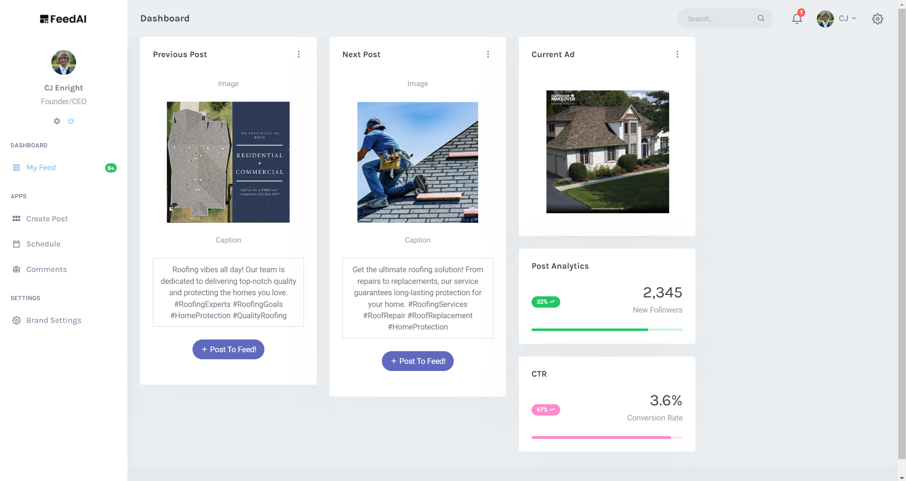

# Feadl.io V1

> Autonomous social media creator Version 1.0

Truly autonomous social media creation and advertising for small businesses.

## Overview

Feadl.io V1 is an innovative tool that empowers small businesses to automate their social media content creation and advertising. It intelligently generates engaging posts, manages scheduling, and optimizes ad campaigns, saving you time and effort.

## Features

- **Autonomous Content Creation:** Feadl.io V1 uses advanced AI algorithms to create compelling social media posts tailored to your business.
- **Intelligent Scheduling:** Automate when your posts go live to reach the right audience at the right time.
- **Optimized Advertising:** Let Feadl.io V1 handle your ad campaigns to maximize their effectiveness and boost your online presence.
- **User-Friendly Interface:** Our intuitive interface makes it easy for anyone to manage their social media marketing effortlessly.

## Website

Check out our website [here](https://feadl.io) to learn more about Feadl.io V1 and how it can supercharge your social media strategy.

## Quick Start

To get started with Feadl.io V1, follow these simple steps:

1. Sign up for an account on our website.
2. Connect your social media accounts.
3. Customize your preferences and branding.
4. Sit back and let Feadl.io V1 take care of the rest!

## Support and Contact

For any questions, feedback, or support, feel free to reach out to us at team@feadl.io.

## License

Feadl.io V1 is Copywrite © CJ Enright 2023. All rights reserved.

